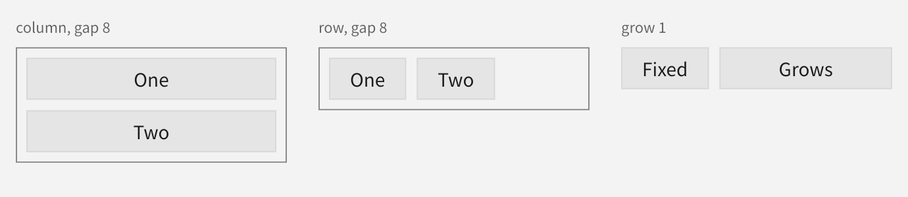
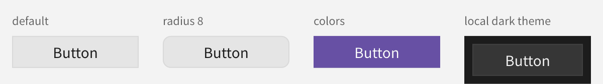
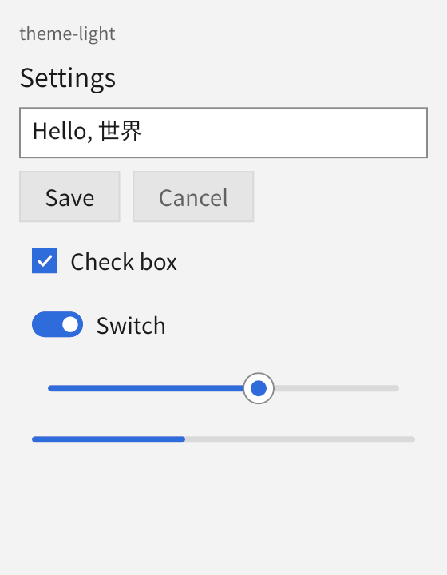
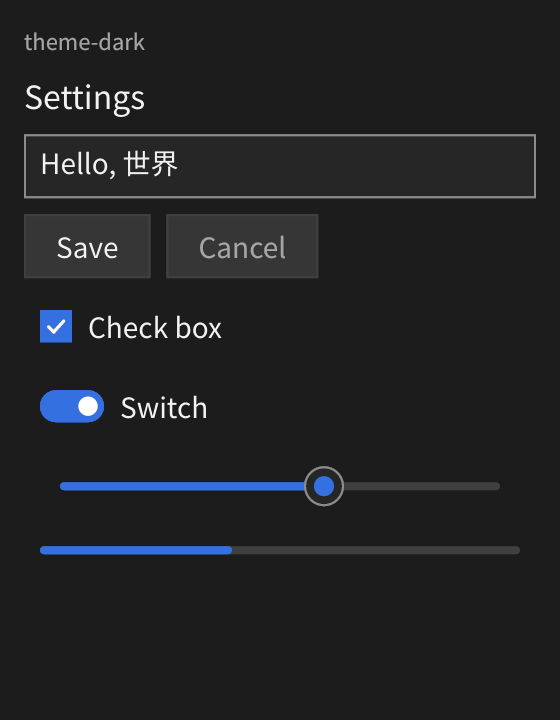
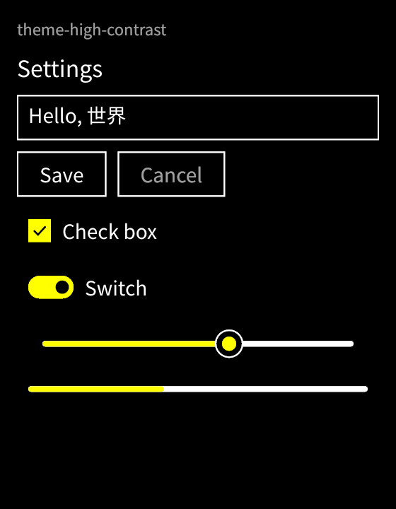

# Aegle 开发者 API 指南

本文面向用 Aegle 编写应用的开发者，按任务介绍当前已实现的接口；不使用 `aegle` facade、只用控件库时见[不经 facade 使用控件库](standalone.md)。各控件的外观、状态和专属方法见[控件参考](controls.md)；架构契约与验证记录分别见[架构与生命周期](../architecture.md)、[标记语言](../markup.md)和[实现状态](../implementation.md)。

Aegle 是保留模式 GUI：控件创建一次，之后通过句柄修改，没有每帧重建界面的入口。创建、修改和读取控件的方法直接返回值，不返回 `Result`；误用是程序错误，会 panic：控件已删除或窗口已关闭（可先用 `is_alive()` 判断）、在绘制器或钩子里使用句柄、传入文档排除的参数（如负宽度、NaN）。会因环境或应用代码失败的操作才返回 `Result<T>`（`aegle::ui::Result`，即 `Result<T, Box<dyn Error>>`，prelude 已引入）：创建 App 与窗口、关闭窗口、加载标记、`refresh` 与输入投递等宿主操作。事件处理器可以返回 `()` 或 `Result`，错误交给 `App::on_error`（见第 7 节），默认不会结束程序。

## 1. 依赖与 feature

引入 facade crate `aegle`。1.0 之前每个 0.x 次版本都可能有破坏性变更，补丁版本不会：

```toml
[dependencies]
aegle = "0.1"
```

| feature | 默认 | 作用 |
| --- | :---: | --- |
| `desktop` | ✓ | `native`、`system-fonts`、`markup`、`motion`、`effects` 与 `desktop-services`，即除渲染器与 Linux 窗口后端以外的默认 feature |
| `native` | ✓ | 原生窗口的宿主；Windows Win32、macOS AppKit 按编译目标选择，Linux 另需 `sdl3`（`aegle` 默认）或 `wayland` |
| `sdl3` | ✓ | Linux：经发行版的 `libSDL3.so.0` 开窗，运行时加载 |
| `wayland` | | Linux：原生 Wayland 客户端，layer-shell、拖动源与 text-input-v3 周边文字；替换 `sdl3` |
| `tiny-skia` | ✓ | CPU 软件绘制（默认渲染器） |
| `system-fonts` | ✓ | 系统字体发现（Linux 用 Pango 的 Fontconfig 配置，运行时加载） |
| `markup` | ✓ | `ui!` 宏与 `aegle::loader` 动态标记引擎 |
| `motion` | ✓ | 外观/位移/缩放旋转过渡、惯性滚动 |
| `effects` | ✓ | `aegle::image::effects`：线性/径向渐变与柔和阴影图像 |
| `colrv1` |  | COLRv1 彩色字形（渐变、变换、混合层），只对 `text-parley` 回退生效；系统栈由 FreeType 处理 |
| `jpeg` / `webp` / `gif` |  | `aegle::image::decode` 解码 JPEG、WebP（静态）、GIF（首帧） |
| `svg` |  | 静态 SVG（无文字）：`aegle::image::svg` 栅格化，并渲染 OpenType-SVG 字形 |
| `grid` |  | 网格与叠放容器（`grid`、`stack`）及标记的 `Grid`/`Stack`；release 约增加 244 KiB |
| `cairo` |  | Linux：经系统 `libcairo.so.2`（运行时加载）的 CPU 绘制，替换 `tiny-skia` |
| `vulkan` |  | Vulkan 1.1 硬件加速绘制（Linux、Windows），替换 `tiny-skia` |
| `wgpu` |  | 全平台通用的最小 wgpu 硬件绘制（macOS 经 Metal），替换 `tiny-skia` |
| `accessibility` |  | 语义树导出，并接上编译目标的系统适配：Linux AT-SPI（引入 zbus）、Windows UI Automation、macOS NSAccessibility。只取语义树而不接系统时直接用 `aegle-ui`/`aegle-widgets` 的同名 feature |

按词移动与双击选词要中日文/泰文分词时，运行环境需要系统分词器：Linux 需安装 `libicu`（多数桌面发行版已随系统安装，程序用 `dlopen` 在运行时查找，`libicui18n.so.<版本>` 与未带版本的 soname 都会探测），Windows 用系统的 `icu.dll`/`icuin.dll`（Windows 10 1903+/1703+），macOS 用系统自带的 `CFStringTokenizer`。都找不到时不报错，也没有回退：按词移动（Ctrl/Alt+←→）与双击选词停用——按键不移动插入点，双击只放置插入点；其余编辑操作不受影响。`aegle_text::segment::available()` 返回当前进程是否找到分词器，环境变量 `AEGLE_SEGMENT=none` 可强制停用以便调试。

Linux 默认后端在运行时加载 `libSDL3.so.0`，构建期不需要任何窗口库头文件；改用 `wayland` 后端时构建需要 libxkbcommon 开发文件（pkg-config），运行需要 libxkbcommon。文字与字形改用系统栈后，运行时还需要 `libpango-1.0.so.0`、`libpangoft2-1.0.so.0`、`libgobject-2.0.so.0`、`libfontconfig.so.1` 与 `libfreetype.so.6`（所有桌面发行版都随系统提供，程序用 `dlopen` 查找，构建时不链接）；完全没有 Pango 的环境里 `TextSystem::system()` 报告不可用。最小化依赖：`default-features = false` 后按需选择，例如 `features = ["native", "sdl3", "tiny-skia"]`（`sdl3` 只在 Linux 生效）并显式注册字体。`native` 只编译目标平台的窗口 crate（另一个平台的 feature 与依赖不进入构建），`accessibility` 同理只编译目标平台的适配器。默认后端让位于显式选择：在默认 feature 之外加上 `wgpu`、`vulkan` 或 `cairo` 即替换 `tiny-skia`，Linux 上加上 `wayland` 即替换 `sdl3`（`aegle = { version = "0.1", features = ["wgpu"] }`）；被替换的 crate 仍参与编译但不进入二进制，`aegle::app::RENDERER` 给出实际使用的渲染器，`cairo`、`vulkan`、`wgpu` 中同时启用两个是编译错误。`aegle` facade 对“`native` 而没有 Linux 后端”在编译期报错（直接用 `aegle-app` 时则保留宿主，`App` 创建时报出缺哪个 feature）。

`use aegle::prelude::*` 引入常用类型；其余名称按来源 crate 分在 `aegle::ui`（引擎、样式、主题、输入与 `scene`）、`aegle::widgets`（默认控件）和 `aegle::app`（`App`、窗口与 `desktop`）下，另有 `aegle::image` 与 `aegle::loader`。

## 2. 最小程序

命令式：

```rust
use aegle::prelude::*;

fn main() -> Result<()> {
    let app = App::new()?;
    let window = app.window("Hello")?;
    window.text("你好，世界");
    app.run()
}
```

标记（`hello.aegle` 与 `main.rs`，路径相对于包的 `Cargo.toml`）：

```text
Window {
    title: "Hello"
    Text { text: "你好，世界" }
}
```

```rust
use aegle::prelude::*;   // 让内置元素在 ui! 处可见，不能省略

fn main() -> Result<()> {
    App::run_ui(aegle::ui!("examples/hello.aegle"))
}
```

可运行示例在 `crates/aegle/examples/`：`hello`、`controls`、`widgets`、`components`、`scrolling`、`visuals`、`dynamic` 等，使用 `cargo run -p aegle --example 名称`。

## 3. 应用与窗口

`App` 是主线程上的原生应用，拥有平台连接、共享字体和 renderer；每个窗口有独立的控件树。

```rust
use aegle::prelude::*;

let app = App::with_options(AppOptions {
    app_id: "com.example.notes".into(),
    theme: Theme::light(),
    ..Default::default()
})?;
let window = app.window_with_options("Notes", WindowOptions { width: 640, height: 480, ..Default::default() })?;
```

| 接口 | 说明 |
| --- | --- |
| `App::new()` / `App::with_options(opts)` | 连接平台并发现系统字体（需 `system-fonts`） |
| `App::with_fonts(TextSystem, opts)` | 使用显式字体集合，不做系统发现 |
| `App::run_ui(build)` | 创建 App、调用构造闭包（如 `ui!` 返回的闭包）并运行 |
| `app.window(title)` / `window_with_options(title, opts)` | 新窗口；`Window` 解引用为根 `Container`（列） |
| `app.run()` | 阻塞运行，直到最后一个窗口关闭或回调返回错误 |
| `app.dispatch(Some(timeout))` | 单步运行，供需要自己循环的宿主；返回是否仍有窗口 |
| `app.preferences()` | 最近应用的系统偏好 `Preferences { dark, high_contrast, reduced_motion }` |
| `app.ime_available()` | 平台是否支持原生输入法组合 |
| `window.close()` | 关闭窗口并使其所有控件句柄失效 |
| `window.scale()` | 窗口最近配置的设备像素比（物理像素/逻辑像素，可为小数），供按设备分辨率渲染的应用纹理使用；窗口关闭后返回错误 |
| `window.ui()` | 窗口的引擎 `Ui`：窗口级 `on_key`、`set_reduced_motion`、`set_token`、`set_default_transition` 等；主题用根节点的 `window.set_theme(theme)` |

`AppOptions` 字段：`app_id`；`theme`、`dark_theme: Option<Theme>`、`high_contrast_theme: Option<Theme>`（按系统偏好选择，`None` 忽略该偏好）；`vulkan`（Vulkan 预算配置）；`wgpu`（字形图集尺寸与窗口透明）；`mask_budget`（软件 mask 字节上限，默认不限）；`transition: Option<Transition>`（交互控件默认过渡，默认 120 ms ease-out）；`reduced_motion: Option<bool>`（`None` 跟随系统）。注意：渲染器由构建期 feature 决定（`tiny-skia` 默认，启用 `cairo`、`vulkan` 或 `wgpu` 时用它），一个二进制只链接一个渲染器，`AppOptions` 不包含渲染器选择字段。

窗口管理作用于普通窗口（层与弹出层返回角色错误）。尺寸指内容区（不含标题栏与边框）的逻辑像素，位置指内容区左上角在桌面逻辑坐标（与 `OutputInfo::position` 同一空间）中的位置；结果随窗口配置异步到达，系统可能调整请求：

```rust
use aegle::app::WindowMode;

let window = app.window_with_options("Notes", WindowOptions {
    width: 900,
    height: 600,
    min_size: Some((480, 320)),
    position: Some(saved_position),   // 上次保存的位置
    mode: WindowMode::Maximized,      // 最后应用：还原时回到上面的尺寸与位置
    ..Default::default()
})?;
window.on_close(move || {
    save_state(window_handle.position()?, window_handle.size()?)?;
    Ok(true)                         // Ok(false) 保持窗口打开，如询问是否保存
})?;
```

| 窗口管理 | 说明 |
| --- | --- |
| `window.size()` / `set_size(w, h)` | 最近配置的内容尺寸 / 调整内容尺寸（限制在尺寸约束内）；最大化、最小化或全屏时返回错误，先还原 |
| `window.set_size_limits(min, max)` | 用户可调整的内容尺寸范围，`None` 不限该侧，并把当前尺寸移入范围；最小值大于最大值返回错误 |
| `window.set_resizable(b)` | 用户能否调整尺寸、从标题栏最大化；程序调用不受影响 |
| `window.mode()` / `set_mode(WindowMode)` | `Normal`、`Maximized`、`Minimized`、`Fullscreen`；过渡可能有动画、在之后的调度中完成，到达后 `mode()` 才报告；尚未显示的窗口在首次显示时进入该模式。Wayland 可请求最小化但从不报告 `Minimized` |
| `window.position()` / `set_position(Point)` | 内容区左上角的桌面逻辑坐标 / 移动窗口；非 `Normal` 模式下移动返回错误。Wayland 不给客户端位置，返回 `Unsupported`；Windows 用窗口当前缩放换算物理像素 |
| `window.set_always_on_top(b)` | 保持在普通窗口之上；Wayland 返回 `Unsupported` |
| `window.on_close(\|\| -> Result<bool>)` | 用户请求关闭（关闭按钮、系统快捷键）时在所有运行时借用之外调用；返回 `Ok(false)` 保持打开，错误交给 `App::on_error` 并保持打开。`window.close()` 不询问，系统撤销的弹出层也不询问；后设置的处理器替换先前的 |

`WindowOptions` 字段：`width`、`height`（逻辑像素建议值）、`buffer_budget`（软件呈现字节上限，默认不限）；`resizable`（默认 true）、`min_size`/`max_size: Option<(u32, u32)>`、`position: Option<Point>`（`None` 由平台放置）、`mode: WindowMode`（在尺寸与位置之后应用）与 `always_on_top`，非默认值在窗口创建后依次应用，失败时窗口不创建；以及 `layer: Option<LayerOptions>`：用桌面 shell 的层（Wayland wlr layer-shell）创建面板/背景/覆盖层，没有层的平台（SDL3、Windows、macOS）创建失败并返回 `Unsupported`。`LayerOptions` 实现 `Default`（`Layer::Top`、无锚定、零保留区、不取键盘焦点），另有 `margin: [i32; 4]`（上右下左）与 `output: Option<OutputId>`（所在输出，`None` 由合成器选择）：

```rust
use aegle::app::{Anchor, LayerOptions};

let output = app.output("DP-1")?;        // 或 app.outputs()? 遍历全部输出
let layer = LayerOptions {
    anchor: Anchor::TOP | Anchor::LEFT | Anchor::RIGHT,
    exclusive_zone: 32,
    output: Some(output.id),
    ..Default::default()
};
let panel = app.window_with_options("", WindowOptions { height: 32, layer: Some(layer), ..Default::default() })?;
// 原地改变放置与建议尺寸，保留原生 surface、控件与状态；不能换输出
panel.set_layer(LayerOptions { anchor: Anchor::BOTTOM | Anchor::LEFT, ..layer }, 300, 32)?;
```

| 输出与弹出层 | 说明 |
|---|---|
| `app.outputs()`、`app.output(name)` | 已连接输出的 `OutputInfo`（`id`、`name` 如 `DP-1`、`description`、逻辑 `position`/`size`、`scale`）；macOS 为 `NSScreen`（名称为本地化显示器名）；Win32 暂返回 `Unsupported` |
| `app.on_outputs(\|app\| ...)` | 输出增删或几何变化后，每轮调度最多调用一次，在所有运行时借用之外，可开关窗口（如每个输出一个面板） |
| `window.popup(PopupOptions::new(anchor, w, h))` | 依附于该窗口（普通窗口、层或另一弹出层）的原生弹出 surface，有自己的控件树，可超出父窗口（如面板的菜单）。`anchor` 为父窗口逻辑坐标矩形（如控件的 `bounds()`），`side` 选 `Side::Below/Above/Left/Right`，越界时由系统翻转或滑动；`grab: true`（默认）取得键盘并在外部按下时关闭，应在按下处理器里打开；`false` 为被动提示。父窗口关闭时其弹出层先关闭；系统撤销弹出层时它自行关闭。Wayland 用 xdg_popup，SDL3 用弹出菜单/提示窗口（只滑动不翻转），macOS 用无边框子窗口（创建时翻转与滑动），Win32 返回 `Unsupported` |

## 4. 控件树与句柄

在 `Container`（列、行、滚动视图、Popup 和窗口根）上创建子控件，新控件追加到末尾：

| 方法 | 返回 | 控件 |
| --- | --- | --- |
| `column()` / `row()` | `Container` | 纵向 / 横向容器 |
| `scroll_view()` | `Container` | 可滚动列，用 `Node` 的滚动方法移动 |
| `list_view(height, count, row)` | `ListView` | 虚拟列表；`height` 为等高行的 `f32`，或 `RowHeight::Estimate(估计)` 表示行高随内容变化 |
| `text(s)` | `Label` | 文本 |
| `button(s)` | `Button` | 按钮 |
| `text_field(s)` / `text_area(s)` | `TextField` | 单行 / 多行编辑器 |
| `check_box(s, checked)` / `switch(s, checked)` | `CheckBox` / `Switch` | 二态控件；复选框可 `set_mixed` 为三态 |
| `radio(s, checked)` | `Radio` | 单选按钮，同一父容器内互斥 |
| `dropdown(items, selected)` | `Dropdown` | 下拉选择 |
| `table(columns, row_height, rows, cell)` | `Table` | 表头加虚拟行的表格 |
| `slider(min, max, value)` / `progress(min, max, value)` | `Slider` / `Progress` | 数值控件 |
| `image(&Image)` | `ImageView` | 图像 |
| `canvas(painter)` | `Canvas` | 自定义绘制 |

`Image` 是共享的、不可变的 RGBA8 像素（非预乘 sRGB，自上而下）。从文件加载图像用 `aegle::image::decode(&bytes)?`（PNG 总是可用），或用 `aegle::image::png::decode` 取得原始像素；任意色彩类型、调色板、`tRNS` 和 16 位都会转为 RGBA8，伽马与 ICC 块被忽略，默认解码结果不超过 64 MiB（`decode_with_limit` 可调整），宽高不超过 16,384，超限返回 `image::Error::TooLarge`，不是支持的格式返回 `Unsupported`，损坏返回 `Invalid`。

其他格式在可选 feature 后：`aegle::image::decode(&bytes)` 按签名识别 PNG 与已启用的 JPEG/WebP/GIF，返回直接可用的 `Image`（错误为 `image::Error::{Unsupported, Invalid, TooLarge}`，`decode_with_limit` 调整字节预算）；`aegle::image::svg::rasterize(&bytes, width, height)` 把静态 SVG 栅格到指定尺寸，`svg::size` 读取固有尺寸，SVG 文字与外部文件不支持。渐变和阴影用 `aegle::image::effects::{linear_gradient, radial_gradient, shadow}` 生成 `Image`，再用 `image(&image)` 控件或 `Canvas` 里的 `builder.image` 绘制。

所有类型化句柄都解引用为 `Node`（`Container`、`Popup` 和 `Window` 经 `Container`），共享以下方法。ListView、Table、Tabs、MenuBar 与 Splitter 这类组合控件只解引用为 `Node`，不能直接添加子控件：

| `Node` 方法 | 说明 |
| --- | --- |
| `is_alive()` | 控件是否仍存在；删除后其他方法会 panic |
| `bounds()` / `visible_bounds()` | 最近刷新后的窗口逻辑坐标 / 与祖先视口的交集 |
| `remove()` / `reparent(&container)` | 删除子树 / 移到另一容器末尾 |
| `set_visible(b)` / `set_enabled(b)` | 作用于整棵子树；隐藏不占布局 |
| `focus()` / `ensure_visible()` | 聚焦 / 滚动祖先使其可见 |
| `set_cursor(Option<Cursor>)` / `cursor()` | 设置/读取该控件及其后代上的鼠标指针形状，`None` 恢复默认 |
| `set_accessible_label(s)` | 无障碍名称 |
| `keep_alive(value)` | 让任意值与控件同生命周期 |
| `popup()` | 创建锚定于该控件的弹出层 `Popup`（`show` / `show_at` / `hide` / `is_shown`）；来自 `NodeWidgets` trait |
| `menu()` / `context_menu()` | 创建锚定于该控件的菜单；后者在上下文菜单请求处显示，见[控件参考](controls.md#menu--menubar)；来自 `NodeWidgets` |
| `request_paste()` | 请求宿主读取剪贴板并作为粘贴交给焦点控件（交互 Canvas 收到 `CanvasEvent::Paste`）；复制用 `copy_text(text)` |
| `set_tooltip(text)` | 悬停提示，同时作为无障碍描述；`None` 移除；来自 `NodeWidgets` |

**鼠标指针形状**：原生窗口会自动跟随。可用形状见 `Cursor`（`Default`、`Text`、`Pointer`、`Crosshair`、`Move`、`Grab`、`Grabbing`、`NotAllowed`、`ResizeHorizontal`、`ResizeVertical`）。规则按优先级：按下后捕获指针的控件（拖选文字时指针移出字段仍是 I-beam）；鼠标下最上层可见控件上的显式 `set_cursor`；可用的文本字段（含只读，因为文字可选）显示 I-beam，禁用的字段不显示；最近祖先的显式形状；箭头。滚动条条带与拖动滚动条始终是箭头；已显示的弹出层遮住其下方的控件。按钮默认不变手形，这是桌面惯例，需要时对按钮或链接式标签 `set_cursor(Some(Cursor::Pointer))`。Windows 没有抓手光标，`Grab` 用手形、`Grabbing` 用四向箭头；macOS 没有四向箭头，`Move` 用闭合手形。

句柄是弱引用：丢弃句柄不会删除控件；删除控件或关闭窗口后，其句柄的其他调用以 `UiError::DeadHandle` 的消息 panic，`is_alive()` 返回 false。句柄可以克隆后移入回调；可能比控件活得久的回调（后台任务、`App::proxy`）应先检查 `is_alive()`。

## 5. 布局

布局由 Taffy 计算，规则与 CSS flexbox / grid 相同。行、列的子控件沿主轴排列，交叉轴默认拉伸。长度参数接受 `f32`（逻辑像素）、`Option<f32>`（`None` 为自动）或 `Length::{Px, Percent, Auto}`；百分比相对父内容框，写 0–100。四边参数接受 `f32`、`Length` 或 `Insets::{all, symmetric(水平, 垂直), new(上, 右, 下, 左)}`。非有限值、负尺寸等不合法输入返回 `UiError::InvalidValue`。

| 子项方法（`Node`） | 说明 |
| --- | --- |
| `set_width`、`set_height` | 尺寸，逐轴设置；自动高度会替换控件的主题高度 |
| `set_min_width`、`set_min_height` | 最小尺寸；自动表示由内容决定 |
| `set_max_width`、`set_max_height` | 最大尺寸；自动表示不限 |
| `set_aspect_ratio(r)` | 宽/高比，一边自动时由另一边推出；`None` 移除 |
| `set_grow(f)`、`set_shrink(f)`、`set_basis(len)` | 分配剩余空间、空间不足时的收缩比例（默认 1）、增减前的主轴尺寸 |
| `set_align_self(Align)` | 覆盖父容器的交叉轴对齐；网格中为纵向对齐；`None` 跟随父容器 |
| `set_margin(insets)` | 外边距，可为负；左右都为 `Length::Auto` 时水平居中 |
| `set_absolute(insets)` | 移出流式布局，按父容器内边距框的四边定位并绘制在兄弟之上；`None` 恢复 |
| `set_padding(insets)` | 内边距；容器接受任意四边，文字控件只接受统一像素值 |
| `set_gap(行间距, 列间距)` | 子控件间距，顺序同 CSS `gap` 与标记 `gap: [行, 列]` |

| 容器方法（`Container`） | 说明 |
| --- | --- |
| `row()`、`column()` | 追加行、列 |
| `contents()` | 追加透明分组：其子控件直接参与本容器的行、列、换行或网格布局，可整体显示、隐藏或替换 |
| `set_direction(Direction)` | `Row`、`Column`、`RowReverse`、`ColumnReverse` |
| `set_wrap(Wrap::Wrap)` | 放不下时换行，类似 QML `Flow` |
| `set_align_items(Align)` | 交叉轴对齐：`Start`、`End`、`Center`、`Stretch`、`Baseline`；`None` 恢复拉伸 |
| `set_justify_content(Justify)` | 主轴剩余空间：`Start`、`End`、`Center`、`SpaceBetween`、`SpaceAround`、`SpaceEvenly` |
| `set_align_content(Justify)` | 换行后各行之间（网格中各行之间）的剩余空间 |

```rust
let bar = window.row();
bar.set_justify_content(Justify::SpaceBetween);
bar.set_align_items(Align::Center);
bar.text("标题");
bar.button("设置");

let tags = window.row();
tags.set_wrap(Wrap::Wrap);
tags.set_gap(6.0, 6.0);

let fab = window.button("+");
fab.set_absolute(Insets::new(Length::Auto, 24.0, 24.0, Length::Auto));
```

**网格与叠放**（facade `grid` feature，release 约增加 244 KiB）：

| 方法 | 说明 |
| --- | --- |
| `grid()` | 追加网格；用 `set_columns` 给出列，子控件逐行填入，行不够时自动增加 |
| `stack()` | 追加叠放容器：所有子控件位于同一格并互相覆盖，容器至少与最大的子控件一样大，后加的绘制在上面 |
| `set_columns`、`set_rows`、`set_auto_columns`、`set_auto_rows` | 显式轨道与自动增加的轨道；显式轨道接受 `Track` 列表，或可命名线与 `Repeat` 的 `TemplateItem` 列表 |
| `set_flow(Flow)`、`set_justify_items(Align)` | 自动放置顺序（`Row`、`Column`、`RowDense`、`ColumnDense`）；子项在格内的水平对齐 |
| `set_grid_column(Placement)`、`set_grid_row(Placement)`、`set_justify_self` | 子项位置：`Placement::at(2)`、`Placement::at(1).spanning(2)`、`Placement::span(2)`；线号从 1 开始，负数从末尾数 |

`Track` 有 `Px`、`Percent`、`Fr`（按份分配剩余空间）、`Auto`、`MinContent`、`MaxContent`、`FitContent(px)` 与 `MinMax(px, fr)`。

```rust
let cards = window.grid();
cards.set_columns(&[Track::Px(160.0), Track::Fr(1.0), Track::Fr(1.0)]);
cards.set_auto_rows(&[Track::Px(96.0)]);
let wide = cards.column();
wide.set_grid_column(Placement::at(2).spanning(2));

let avatar = window.stack();
avatar.image(&photo);
let badge = avatar.text("3");
badge.set_align_self(Align::Start);
badge.set_justify_self(Align::End);
```

**最小尺寸与窗口**：与 CSS flex 一样，容器在主轴上的最小尺寸默认由内容决定，但滚动的一轴不把内容向上传：ScrollView、ListView 与表格的最小内容尺寸只有自身的内边距、边框和最小尺寸，所以它们和包含它们的每一层行/列、标签页都能收缩到窗口给的空间，超出部分在视图内滚动，不需要在中间容器上写 `set_min_height(0.0)`。反过来，滚动方向上的直接子项不收缩，保持自身尺寸并滚动。单行和多行文本框横向可收缩（最小宽度 0，文字在框内滚动），一行放不下文本框和按钮时缩的是文本框。要让一个内容很多的子项只占剩余空间，用 `set_basis(0.0)` 加 `set_grow(1.0)`，否则它会从完整内容尺寸开始参与收缩。

默认值来自主题：控件高 32、间距 8、窗口根内边距 8，文字 14。显式设置的高度、最小高度、内边距和间距在切换主题后保留。文字按父宽度自动换行。内容超出时放进 `ScrollView` 或 `ListView`。标记中的对应写法见[标记语言](../markup.md)。



## 6. 外观：主题、样式与皮肤

**主题** `Theme` 是一组颜色、阴影与尺寸：`background`、`surface`、`control`（按钮底色）、`foreground`、`muted`、`border`（输入轮廓）、`divider`（安静线条）、`accent`、`on_accent`、`hover`/`pressed`（半透明叠层）、`shadow`（浮层阴影）、`font_size`、`padding`、`gap`、`radius`（默认 0，直角）、`control_height`（默认 32）；文本选择色由 `Theme::selection()` 派生。内置 `Theme::light()`、`dark()`、`high_contrast()`，可修改字段后用 `validate()` 检查。

```rust
window.set_theme(Theme { radius: 6.0, ..Theme::dark() });  // 整个窗口：根节点的局部主题
panel.set_theme(Theme::dark());                           // 只作用于 panel 子树
panel.set_theme(None);                                    // 恢复继承
// 只替换指定 token，其余跟随父主题（含之后的变化）
panel.set_theme_override(ThemeOverride { accent: Some(Color::rgb(200, 40, 40)), ..Default::default() });
```

原生 `App` 把系统文本缩放（Windows 的文本大小、GNOME 的 `text-scaling-factor`，百分比）应用到解析后主题的 `font_size` 与 `control_height`；`AppOptions.text_scale = Some(125)` 可显式指定，`None`（默认）跟随系统。

**局部样式** 覆盖单个控件，优先于皮肤和主题。`set_style(Style { .. })` 一次写入全部字段（未给出的字段回到皮肤值），`style()` 读取，`appearance()` 返回当前解析结果；逐项 setter 是它的单字段简写，只写自己那一项：

```rust
card.set_style(Style { background: Some(Color::WHITE), radius: Some(8.0), ..card.style() });
card.set_border_width(1.0);   // 等同于只改 Style::border_width
```

所有控件都有 `set_background`、`set_foreground`、`set_border_color`、`set_border_width`、`set_radius`、`set_disabled_background`、`set_disabled_foreground`；传 `None` 让该项回到皮肤值。`set_cut(true)` 让节点以自身形状挖穿下面已画的内容（代替背景）；`set_shader(Shader::new(wgsl))` 与 `set_shader_values(&[..])` 用自定义片元程序代替背景（`shaders` 特性的 `ShaderView` 先用 `aegle_gpu::check_shader` 校验，错误走 `on_error`）；`set_inset_shadow(Shadow { .. })` 在背景上沿边缘画内阴影（同 CSS `inset`，blur 必须为正）；`set_corners(Corners { bottom_left: true, bottom_right: true, ..Corners::NONE })` 让圆角只作用于部分角（默认 `Corners::ALL`），背景、边框、焦点环、阴影、图层与背景模糊都跟随；标记写 `corners: [bottom_left, bottom_right]`。只对部分控件有意义的 setter 只出现在对应句柄上，用错控件在编译期报错：

可清除的属性只有一个 setter：传值设置，传 `None` 清除（参数为 `impl Into<Option<T>>`），没有另外的 `clear_*` 方法。这适用于样式与字体、主题与覆盖、token 覆盖、过渡、对齐、绝对定位、宽高比、光标、布局方向、无障碍描述、提示和菜单快捷键提示。皮肤是函数指针，Rust 不会把函数项隐式转换进 `Into`，因此 `set_skin`、`set_kind_skin` 保持 `Some(skin)` / `None`。

| 方法 | 所在句柄 |
| --- | --- |
| `set_font_size`、`set_font`（`None` 回到主题字号或默认字体）、`font` | Label、Button、Dropdown、TextField、NumberField、CheckBox、Switch、Radio |
| `set_hover_background`、`set_focus_color`、`set_focus_width` | Button、Dropdown、TextField、NumberField、CheckBox、Switch、Radio、Slider |
| `set_pressed_background` | Button、Dropdown、CheckBox、Switch、Radio、Slider |
| `set_indicator_color` | CheckBox、Switch、Radio、Slider、Progress |
| `set_selection_color`、`set_caret_color` | TextField、NumberField |

`Style` 是值，其中不适用于该控件的字段在运行时以 `UiError::WrongKind` panic。

**优先级**：一个外观属性的显示值按下表自上而下取第一个存在的来源。

| 层 | 来源 | 写入 | 移除 |
| --- | --- | --- | --- |
| 呈现 | 进行中的过渡或动画（`motion`） | `set_transition`、`with_transition`、`animate` | 到达目标；`finish_transition`、`cancel_transition`、`snap` |
| 本地值 | 常量或 token 绑定，同一属性只能是其中之一，后写者生效 | setter、`set_style`；`bind_color`、`bind_length`、`bind_font`、`bind_shadow` | setter 传 `None`、`set_style(Style::default())`、`unbind_token` |
| 节点皮肤 | 该控件自己的皮肤 | `set_skin(Some(skin))` | `set_skin(None)` |
| 类型皮肤 | 最近的祖先（含自身）为该控件类型设置的皮肤 | `set_kind_skin(&kinds::BUTTON, Some(skin))` | `set_kind_skin(kind, None)` |
| 默认皮肤 | 控件类型（`ControlKind`）自带的皮肤 | 由控件库登记类型时给出 | — |
| 主题 | 最近的局部主题与覆盖，再到窗口主题 | `set_theme`、`set_theme_override`、`set_token` | 传 `None` |

三层皮肤是同一机制的不同作用范围：每个节点只缓存解析出的那一个皮肤，设置、reparent 或新建控件时只重新解析受影响的子树，绘制时不查找祖先。本地值和皮肤内部再按控件状态取值：disabled → pressed → hover → 基础值，某状态没有指定时用基础值；焦点环单独绘制。“后写者生效”意味着：setter 写一个字段并结束该字段的 token 绑定；`set_style` 写全部字段，因此结束全部样式绑定；`bind_*` 让该字段改为跟随 token。

**Token** 是登记过名称的类型化值（`Color`、`f32` 长度、`Duration`、`Font` 或 `Shadow`），默认值随主题变化；17 个 Theme 字段即内置 token（`Theme::ACCENT` 等，名为 `theme.accent`）。属性绑定 token 后随主题、覆盖与 reparent 自动更新：

```rust
fn lane(theme: &Theme) -> Color { theme.accent }

// 组件包登记一次：名称加随主题变化的默认值（纯函数）
let fill = register_token("studio.lane", lane)?;
let space = register_token("studio.space", |theme: &Theme| theme.gap * 2.0)?;
let heading = register_token("studio.heading", |_: &Theme| Font { weight: 700, ..Font::DEFAULT })?;
let speed = register_token("studio.speed", |_: &Theme| Duration::from_millis(160))?;

play.bind_color(ColorSlot::Background, fill);        // 随主题、覆盖与 reparent 更新
row.bind_length(LengthSlot::Gap, space);             // 也可绑定 padding、字号、边框与圆角
title.bind_font(heading);
play.bind_transition(TransitionProperty::Paint, speed, Easing::EaseOut);

panel.set_token(fill, Color::rgb(200, 40, 40));       // 只覆盖 panel 子树
window.set_token(space, 4.0);                          // 整个窗口
play.set_background(Color::WHITE);                     // 后写者生效：改为常量，结束该项绑定
```

若某个绑定拒绝新值（例如字号变为 0），`set_token`、`set_theme`、`set_theme_override` 与 `reparent` 返回错误且不做任何改变。标记中写 `background: token("studio.lane")`，见[标记语言](../markup.md)。

**皮肤** 是纯函数 `fn(&Theme, VisualState) -> Appearance`，可替换外观而不改行为。每个控件有一个类型（`ControlKind`，内置类型在 `aegle_widgets::kinds`：`BUTTON`、`TAB`、`MENU_ITEM`、`TEXT_FIELD`、`CHECK_BOX`、`SWITCH`、`RADIO_BUTTON`、`SLIDER`、`PROGRESS`、`LABEL`、`SCROLL_VIEW`、`PANEL`、`MENU_BAR`、`TOOLTIP`，布局容器为 `aegle_ui::CONTAINER`），类型自带默认皮肤；皮肤可以只给一个控件，也可以给一个子树里某类型的全部控件：

```rust
fn primary(theme: &Theme, state: VisualState) -> Appearance {
    Appearance {
        background: if state.pressed { Color::rgb(66, 45, 103) } else { Color::rgb(103, 80, 164) },
        foreground: Color::WHITE,
        radius: 18.0,
        ..Appearance::base(theme, state)   // 透明、无边框、主题前景色与焦点环
    }
}
window.set_kind_skin(&kinds::BUTTON, Some(primary));  // 窗口里所有按钮，含之后新建的
dialog.set_kind_skin(&kinds::BUTTON, None);          // 移除该子树上的规则
save.set_skin(Some(primary));                        // 只给这一个控件
```

`VisualState` 含 `kind`、`enabled`、`hovered`、`pressed`、`focused`、`read_only`、`checked`；`(state.kind.skin)(theme, state)` 得到类型的默认外观，可在其上修改。



不同主题下的同一组控件：

  

原生 App 默认跟随系统深浅色、高对比与减少动态效果（见第 3 节 `AppOptions`）。高对比主题以对黑底 8:1 的灰色显示禁用和次要文字，与白色的启用控件可区分。

## 7. 事件与回调

```rust
let status = window.text("Ready");
let save = window.button("Save");
save.on_click(move |_button| status.set_text("Saved"));
```

| 控件 | 事件 |
| --- | --- |
| `Button` | `on_click(FnMut(Button))` |
| `TextField`（单行） | `on_submit(FnMut(TextField))`，Enter 触发 |
| `TextField`（单/多行） | `on_change(FnMut(TextField))`：用户改变已提交文字后（键入、删除、粘贴、剪切、撤销/重做、输入法提交）；预编辑与 `set_text` 不触发 |
| `CheckBox` / `Switch` / `Radio` / `Slider` / `NumberField` / `Dropdown` / `Tabs` | `on_change(FnMut(Self))` |
| 任意控件（`motion`） | `on_transition_end(FnMut(Node))` |
| `Canvas` | `set_input(FnMut(Canvas, CanvasEvent))`：指针、滚轮、按键、焦点与粘贴，见[控件参考](controls.md#canvas) |
| 任意控件 | `on_double_click(FnMut(Node))`：主键在该控件或没有自己处理器的后代上双击，在按下的默认行为之后执行 |
| 任意控件 | `on_context_menu(FnMut(Node, Point))`：在该控件或没有自己处理器的后代上请求上下文菜单——右键按下（得到按下点），或焦点在其中时按 Menu 键、Shift+F10，或辅助技术的 ShowContextMenu（得到该控件左上角）；点为窗口逻辑坐标，可直接交给 `Popup::show_at` |
| 任意控件 | `on_drop(FnMut(Node, DropEvent))`：成为该控件及没有自己处理器的后代的放置目标。每次拖动经过先得到 `DropEvent::Enter`，再得到一次 `Leave` 或 `Drop { data, position }`（`data` 为 `DragData::Text` 或 `DragData::Files`，`position` 为窗口逻辑坐标）；有处理器即接受文字与文件，不用的数据忽略即可 |
| `MenuItem` | `on_click(FnMut(MenuItem))`：菜单关闭、勾选项切换之后执行 |

- 回调在本批输入处理后、所有 UI 借用之外执行，可以自由创建、修改或删除控件，包括关闭窗口。
- `on_*` 一律追加：同一事件可以注册多个处理器，按注册顺序执行，处理器与控件同生命周期；`on_*` 返回 `Subscription`，需要时 `remove()` 撤掉这一个处理器。指针、按键与滚轮另可用 `on_input_capture`/`on_input` 在默认行为前沿祖先链捕获与冒泡，`stop_propagation`、`prevent_default` 控制传播与默认行为。标记里的 `on clicked` 与 Rust 的 `on_click` 因此可以共存。
- 处理器可以返回 `()`，也可以返回 `Result` 以便在里面用 `?`（`HandlerResult` trait 接受两者）。回调返回错误时处理器保留，同一事件的其他处理器照常执行。原生 App 把错误交给 `app.on_error(|error| ...)`：返回 `Ok(())` 继续运行，返回错误则结束 `App::run`；没有设置时打印到 stderr 并继续。无窗口 `Ui::dispatch_callbacks` 把第一个错误返回给宿主，后续排队的回调留到下次调用。
- 程序 setter（`set_checked`、`set_value`、`set_text` 等）不触发回调，可安全地相互同步；`activate()`、`toggle()`、`increment()`/`decrement()` 模拟用户操作并触发回调。
- `set_*` 替换：`Canvas::set_input` 与 `set_painter` 一样是画布自身的行为，再次设置会替换。

### Rust 侧响应式状态（`Signal`）

纯 Rust 应用把状态放进 `Signal<T>`，界面从它派生，不必在每个修改处手写“模型 → 控件”的同步：

```rust
let name = Signal::new(String::from("世界"));
let volume = Signal::new(40.0);
let muted = Signal::new(false);

window.text_field("").bind_text(&name);              // 双向：显示 name，用户编辑写回 name
window.slider(0.0, 100.0, 0.0).bind_value(&volume);
window.check_box("静音", false).bind_checked(&muted);

// 派生值：由两个 signal 算出，结果不变时（静音中拖动滑块）读它的绑定不重跑
let (quiet, level) = (muted.clone(), volume.clone());
let audible = Derived::new(move || if quiet.get() { 0.0 } else { level.get() });

let who = name.clone();
audible.bind(&window.text(""), move |summary, volume| { // 读了 audible 与 name，任一变化都重跑
    summary.set_text(&format!("你好，{} — 音量 {volume:.0}", who.get()));
});
window.button("重置").on_click(move |_| {                // 只改模型，控件随之更新
    aegle::ui::batch(|| { name.set("世界".into()); volume.set(40.0); muted.set(false) })
});
```

- `Signal::new(v)` 创建，克隆共享同一个值；`get()`（要求 `Clone`）与 `with(|v| ...)` 读取，`set(v)` 在值相等时什么也不做，`update(|v| ...)` 原地修改并总是通知。Signal 不是 `Send`，后台线程经 `app.proxy` 在 UI 线程里修改。
- `signal.bind(&控件, |控件, 值| ...)` 立即运行一次，之后在该 signal 或闭包里读到的任何其他 signal 变化时重跑；依赖按最近一次运行实际读到的 signal 计算，未走到的分支不订阅。绑定与控件同生命周期：控件删除或窗口关闭时，闭包与其捕获的值一起释放。闭包不会被自己引起的变化重入，也不能修改它正在读的这个 signal（会 panic）。
- `signal.on_change(|新值| ...)` 在每次变化、所有绑定重跑之后以新值调用，处理器里的读取不订阅、自己引起的变化不重入；处理器归 signal 所有，捕获该 signal 自身时会让它一直存活，直到移除。处理器可以返回 `()` 或 `Result`：修改 signal 的地方没有错误可返回，错误先排在 UI 线程上，原生 App 在每轮回调后交给 `app.on_error`（无窗口宿主由 `Ui::dispatch_callbacks` 在没有事件处理器失败时返回，或自己循环调用 `aegle::ui::take_reaction_error()`）；处理器保留。
- 派生值：`Derived::new(|| ...)` 或 `signal.map(|v| ...)`（`Derived` 也有 `map`）创建时计算一次，之后在它读到的 signal 或其他派生值变化时重算；结果要求 `PartialEq`，与上次相等时读它的绑定与处理器不重跑。`Derived` 只读，有 `get`、`with`、`bind`、`on_change`；克隆共享同一个值，计算随最后一个克隆或读它的绑定释放。
- 何时重跑：一次修改把读它的反应排入队列，在修改结束、`set` 返回前运行一轮：先派生值，再绑定，最后 `on_change` 处理器，因此绑定看到的派生值总是最新的；同一反应在运行前被多次排入也只运行一次。反应运行中做的修改并入当前这一轮，在它返回后生效，所以绑定闭包里改了别的 signal 后，立刻读其派生值仍是旧值。
- 批量修改：`aegle::ui::batch(|| { ... })` 把其中所有修改的反应推迟到它结束时一起运行，读多个 signal 的绑定只重跑一次，`on_change` 只以最终值调用一次；批量可嵌套，最外层结束时运行。批量内部读到的是已修改 signal 的新值，派生值与控件仍是批量开始前的值。事件处理器里一般不需要批量：反应只经句柄打脏标记，布局与绘制本来就在下一次刷新时合并进行一次，批量省下的是绑定闭包的重复运行。
- 反应 panic 时，这一轮剩下的反应留在队列里，在下一次修改的那一轮运行。和句柄一样，不能在绘制器、钩子或场景访问器里修改 signal。
- 输入控件的双向绑定：`CheckBox`/`Switch::bind_checked(&Signal<bool>)`、`TextField::bind_text(&Signal<String>)`、`Slider`/`NumberField::bind_value(&Signal<f64>)`、`Dropdown`/`Tabs::bind_selected(&Signal<usize>)`，单选按钮组为每个按钮 `Radio::bind_choice(&Signal<T>, 值)`（signal 等于该值时选中，用户选中时设为该值）。用户修改经控件的 `on_change` 写回；控件已显示的值不会再被设一次，所以正在编辑的文本框保留插入点、选区与撤销历史。滑块与数值框把超出范围的值钳制显示，signal 保留给定值，直到用户改动控件。
- `bind`、`on_change`（`Derived` 的同名方法同样）与 `bind_*` 返回 `Binding`，`remove()` 停止它（双向绑定的两个方向一起停止）；丢弃 `Binding` 不会停止。自定义控件库的双向绑定可以用 `Binding::with_subscription` 把写回处理器的 `Subscription` 并入同一个 `Binding`。
- 与标记互通：标记文档的 `state` 是 `aegle::loader::State<T>`，`state.bind_signal(&signal)?` 把它与同类型的 `Signal<T>` 双向连接（`T` 为 `bool`、`i64`、`f32`、`String`、`Vec<i64>`、`Vec<String>` 或 `Data`）：连接时 state 取 signal 的值，之后事件块、绑定源或 Rust 对任一方的修改都同步到另一方，对方已相等时停止回传。连接跟随保留该 state 的重载；把 signal 的修改写入 state 时的错误（非有限浮点数、标记里的绑定或处理器失败）按上一条交给宿主。返回的 `Binding` 的 `remove()` 同时断开两个方向；连接让 signal 与 state 互相保持存活，直到移除。
- 单向驱动标记：`state.follow(&derived)?` 让 state 跟随 `Derived<T>`：现在取它的值，之后它每次变化都写入 state；Rust 计算、标记显示，标记的修改不回传。事件块仍可给该 state 赋值，该值保持到派生值下次变化。界面保持 `derived` 存活，所以可以直接传临时值（`&signal.map(...)`）；连接跟随保留该 state 的重载，随界面移除或 `Binding::remove()` 结束，结束时释放派生值。错误处理与 `bind_signal` 相同。

  ```rust
  let view = aegle::ui!(&app, "examples/dynamic.aegle")?;   // 文档里有 state tasks: list<string> 与 longest: int
  let tasks = Signal::new(vec![String::from("Write markup")]);
  view.tasks.bind_signal(&tasks)?;                         // 标记按钮改 tasks，Rust 这边跟着变
  tasks.update(|tasks| tasks.sort());                      // 反之亦然
  view.longest.follow(&tasks.map(|tasks| {                 // 标记没有 max，由 Rust 算出后显示
      tasks.iter().map(|task| task.chars().count() as i64).max().unwrap_or(0)
  }))?;
  ```

可运行示例：`cargo run -p aegle --example signals`。

### 逐帧回调与窗口级按键

```rust
// 播放头：每帧读音频时钟并移动一个小控件；只改 offset，不重新布局或重画时间轴。
playhead.on_frame(move |node, now| {
    let x = audio.position_seconds() * pixels_per_second - scroll;
    node.set_offset(Point::new(x, 0.0));
    audio.playing()                              // 返回 false 停止，窗口回到空闲
});

window.ui().on_key(move |key| {
    if key.pressed && !key.editing && key.key == Key::Character(' ') {
        transport.toggle(key.time);              // key.time：平台报告的按键时刻（Instant）
        return true;                             // 消费此键，焦点控件不再收到
    }
    false
});
```

- `Node::on_frame(FnMut(Node, Instant) -> bool)` 每个呈现帧调用一次，按注册顺序，在布局与绘制之前、所有借用之外；返回 `true` 继续，返回 `false` 停止。只要还有逐帧回调，原生窗口就按显示器节奏持续出帧；全部停止后不再唤醒。控件删除时其回调随之移除。
- `Ui::on_key(FnMut(KeyEvent) -> bool)`（原生窗口用 `window.ui().on_key`）在焦点控件和 Tab 遍历之前收到每个按键；多个处理器按注册顺序执行，第一个返回 `true` 的处理器消费该键。`KeyEvent::editing` 表示焦点在文本编辑器中，此时普通字符键通常应留给输入。
- 按键与指针事件带有平台时间：Wayland 的毫秒时间戳、Win32 的 `GetMessageTime` 与 AppKit 的 `NSEvent.timestamp` 被映射到 `Instant`（锚定到最小投递延迟，处理 32 位回绕）。窗口按键处理器从 `KeyEvent::time` 读取，自定义控件从 `InputCx::time` 读取；嵌入宿主用 `key_at`、`pointer_at` 传入。

### 拖放

```rust
// 放置目标：悬停时高亮，放下时读取文件或文字。
zone.on_drop(move |zone, event| match event {
    DropEvent::Enter => zone.set_background(Color::rgb(220, 232, 255)),
    DropEvent::Leave => zone.set_background(Color::WHITE),
    DropEvent::Drop { data: DragData::Files(files), .. } => { zone.set_background(Color::WHITE); open(files) }
    DropEvent::Drop { .. } => zone.set_background(Color::WHITE),
});
// 拖动源：在按下后的移动中发起；控件的按下随即取消，指针交给系统拖动。
canvas.set_input(move |canvas, event| match event {
    CanvasEvent::Move { pressed: true, .. } => canvas.start_drag(DragData::Text("片段".into())),
    _ => {}
});
```

拖放只有复制语义，数据为文字或本地文件列表。外部程序拖入的数据与本应用其他窗口拖出的数据走同一路径（Wayland 经 compositor 的 `wl_data_device`，Windows 经 OLE，macOS 经 `NSDraggingSession`）。Windows 上 `start_drag` 在系统拖动循环中阻塞到放下或取消；macOS 上它立即返回，拖动由 AppKit 事件循环推进。

### 后台线程

UI 句柄只能留在 UI 线程。`let proxy = app.proxy(move |message: Job| label.set_text(&message.text))?;` 返回可克隆、可发送的 `UiProxy<Job>`；任意线程 `proxy.send(job)`（队列上限 1024，满或应用退出时把消息退回）并唤醒事件循环，handler 在 UI 线程于所有借用之外按序运行，可以自由使用其中捕获的控件句柄。

### 桌面服务（`desktop-services`，默认 `desktop` 组合包含）

```rust
use aegle::app::desktop::{Event, FileDialog, Icon, MenuItem, Notification, Shortcut, Tray};

let desktop = app.desktop("org.example.Notes", move |event| match event {
    Event::Files { paths: Some(paths), .. } => status.set_text(&format!("{paths:?}")),
    Event::Unavailable(why) => status.set_text(&why),   // 没有对应的桌面服务
    _ => {}
})?;
let filters: &[(&str, &[&str])] = &[("Text", &["*.txt"])];
desktop.open_file(&FileDialog { title: "Open", filters, ..Default::default() })?;
desktop.notify(&Notification { summary: "Saved", body: "notes.txt", actions: &[("open", "Open")] })?;
desktop.bind_shortcuts(&[Shortcut { id: "toggle", description: "Show", trigger: "Ctrl+Alt+K".parse()? }])?;
let icon = Icon { width: 32, height: 32, rgba: &pixels };     // 非预乘 RGBA8
desktop.set_tray(Some(&Tray { icon, tooltip: "Notes", menu: &[MenuItem::Item { id: 1, label: "Quit", enabled: true, checked: None }] }))?;
```

`App::desktop(app_id, handler)` 建立 `aegle_desktop::Desktop` 并把它的事件经 `UiProxy` 交给 UI 线程上的 handler。请求方法立即返回请求编号（`open_file`/`save_file`/`notify`），结果以 `Event::Files { request, paths }`（取消为 `None`）、`NotificationAction`/`NotificationClosed`、`TrayActivated`/`TrayMenu { item }`、`Shortcut { id }` 送达；系统没有相应服务时得到 `Event::Unavailable`。`set_tray(None)` 移除托盘；再次调用 `set_tray` 原地更新。Linux 上全局快捷键由用户在 portal 对话框中确认，触发键只是首选值。macOS 上 `Desktop` 须在主线程创建和使用（`App::desktop` 即是），事件随应用的 AppKit 循环送达：文件对话框为非模态 `NSOpenPanel`/`NSSavePanel`（没有过滤器菜单，所有过滤器的扩展名一并允许，非 `*.扩展名` 的模式允许全部文件）；托盘为菜单栏 `NSStatusItem`，主键单击报 `TrayActivated`、右键或 Control 单击弹出菜单；全局快捷键为 Carbon 热键，按 ANSI 键位匹配，Ctrl/Alt/Shift/Super 对应 Control/Option/Shift/Command，F21–F24 与被系统拒绝的组合报 `Unavailable`；通知经 `UNUserNotificationCenter`，只在带 bundle identifier 的应用包内可用（裸二进制报 `Unavailable`），首次通知时系统询问授权，拒绝报 `Unavailable`；应用在前台时也显示横幅，按钮报其键、点击正文报 `"default"`，随后报 `NotificationClosed`，关闭只报 `NotificationClosed`。`Desktop` 不依赖窗口，也可脱离 aegle-app 单独使用（`aegle-desktop` crate）。

## 8. 过渡与动画（`motion`）

```rust
use std::time::Duration;

card.set_transition(Transition::new(Duration::from_millis(180), Easing::EaseOut));
card.set_background(Color::rgb(235, 240, 255));      // 外观变化按过渡补间
card.set_offset(Point::new(0.0, 480.0));               // 布局后平移，命中与 IME 跟随
card.on_transition_end(move |_| window.close());       // 全部过渡完成后执行
```

- 外观过渡覆盖背景、文字、边框、圆角、焦点环、选择、caret 和标志颜色；`presented_appearance()` 返回当前呈现值。`set_property_transition(TransitionProperty::Offset, t)` 只给某一项设置时长与曲线，`None` 让该项立即到目标。
- `finish_transition()` 立即到终点并完成；`cancel_transition()` 停在当前呈现值；`set_transition(None)` 移除策略并回到目标。
- `set_offset` 不改变布局；没有过渡策略时立即生效。
- `card.set_transform(Transform { scale: 1.2, rotation: 0.1 })` 以节点中心缩放/旋转子树（弧度，呈现层变换，布局不变），同样可补间；命中、滚动视口裁剪（外包框）、IME 锚点与无障碍变换跟随。
- `ui.fling(position, velocity)` 在触摸板/触摸抬起后继续滚动（逻辑像素/秒，指数衰减），任何新的滚动、按下或 `ui.stop_fling()` 都会停止。
- 手指输入用 `ui.touch(PointerId(..), TouchPhase::Down/Move/Up/Cancel, position, time_ms)`：点击与控件拖动成为指针事件，在非拖动内容上拖动超过 10 px 会平移滚动视图并在抬起时惯性滚动；Wayland 的 `wl_touch` 已接到它。
- 原生 App 为新建的交互控件默认安装 120 ms 过渡，所以 hover/按下/焦点反馈和对它们的 setter 都会补间；`AppOptions.transition = None` 关闭。无窗口 `Ui` 默认不安装，`ui.set_default_transition(Some(Transition::default()))` 得到与原生 App 相同的行为。减少动态效果时所有过渡与动画直接到终点（仍会触发完成回调）。

**只针对一次变化**，不改控件的过渡策略：

```rust
button.snap(|| button.set_background(Color::WHITE));           // 这次不补间
card.with_transition(Transition::spring(Spring::new(300.0, 12.0)?), || {
    card.set_offset(Point::new(0.0, 24.0))                        // 这次按弹簧补间，即使 card 没有策略
});
```

闭包只作用于调用它的控件；闭包结束后，该控件的修改恢复按策略处理。

**显式动画**：`node.animate(Animate::Offset | Scale | Rotation(animation))` 启动一个关键帧动画，从第一帧开始、停在最后一帧，并共用 `is_animating`、`finish_transition`、`cancel_transition` 与 `on_transition_end`：

```rust
let shake = Animation::new(Duration::from_millis(300), [
    Keyframe::new(0.0, Point::new(0.0, 0.0)),
    Keyframe::new(0.25, Point::new(-8.0, 0.0)),
    Keyframe::new(0.75, Point::new(8.0, 0.0)).easing(Easing::EaseInOut),
    Keyframe::new(1.0, Point::new(0.0, 0.0)),
])?;
field.animate(Animate::Offset(shake));

let pulse = Animation::tween(1.0, 1.08, Transition::default())?
    .delay(Duration::from_millis(500))
    .cycles(Cycles::Forever)
    .alternate(true);
badge.animate(Animate::Scale(pulse));                         // 一直运行，直到 finish/cancel_transition
```

曲线：`Easing::{Linear, EaseIn, EaseOut, EaseInOut}`、`Easing::cubic_bezier(x1, y1, x2, y2)?`（同 CSS `cubic-bezier`）与 `Easing::Spring(Spring::new(stiffness, damping)?)`；`Transition::spring(spring)` 使用弹簧自然的稳定时间。回弹曲线会让位移、旋转短暂越过目标。`aegle-motion` 的 `Tween` 与 `Animation` 不依赖窗口，也可在自己的宿主里按时间采样。
- 没有活动动画时不请求帧、不唤醒 CPU。

## 9. 标记语言

`ui!("path.aegle")` 在编译期解析并检查文件，返回构造闭包；`ui!(&parent, "path.aegle")` 立即构造。元素名在调用处按 Rust 作用域解析：`use aegle::prelude::*` 引入内置元素，控件库的元素随其句柄类型导入（见[编写控件库](library.md#6-标记元素)）。返回的 View 有 `root` 和每个 `id` 的类型化字段：

```text
Column {
    gap: 8dp
    Text { id: status; text: "Waiting" }
    Button { id: done; text: "Done" }
}
```

```rust
let view = aegle::ui!(&window, "panel.aegle")?;
let status = view.status.clone();
view.done.on_click(move |_| status.set_text("Finished"));
```

动态文档可声明 state、表达式绑定、事件块、`if`/`for` 和组件：

```text
use "parts.aegle"
Column {
    state count: int = 0
    Text { text: "count " + str(count) }
    Button { text: "Add"; on clicked { count += 1 } }
    if count > 3 { Text { text: "Many" } }
}
```

View 为根节点的每个 state 提供 `aegle::loader::State<T>` 字段（`view.count.get()`、`view.count.set(5)?`），设置后相关绑定立即更新。`view.count.on_change(|v| ...)` 在每次变化（来自事件块或 Rust）且绑定更新后调用处理器，返回可 `remove()` 的 `Watch`；处理器不会被自身对该 state 的修改重入。`view.count.bind_signal(&signal)?` 把 state 与 Rust 的 `Signal` 双向连接，`view.count.follow(&derived)?` 让它单向跟随 Rust 的 `Derived`（见第 7 节“Rust 侧响应式状态”）。运行时加载与重载：

```rust
use aegle::loader::Program;

let mut view = Program::load("ui/panel.aegle")?.build(&window)?; // 第三方元素用 load_with(path, &Elements::new().with::<E>())
view.set("count", aegle::loader::Data::Int(2))?;
view.reload(&Program::load("ui/panel.aegle")?);   // 失败时保留旧界面
```

重载保留同名同类型 state 的值，其 `State` 句柄与 `on_change` 处理器随之转移。根为带 `layer` 的 `Window` 的文档即一个面板：`Program::open(&app)` 直接创建 layer surface，`program.open_on(&app, output.id)` 放在指定输出（每个输出一个面板），重载原地更新放置而不重建 surface（见[标记语言](../markup.md)第五节）。

还可声明 `record`、写 `for item in items key item.id`、在事件块里用 `let`、`emit` 和 `host.name(args)`（宿主用 `aegle::loader::action(name, &[Type], f)` 为本线程的所有程序注册），组件可有 `slot` 与自己的 `event`。完整语法、可绑定属性、类型规则和限制见[标记语言](../markup.md)。

## 10. 嵌入自有宿主

不使用 `App` 时，可以把无窗口 `Ui` 接到自己的窗口系统和 renderer（`default-features = false` 即可；也可以完全不依赖 facade，见[不经 facade 使用控件库](standalone.md)）：

```rust
use aegle::ui::{Size, TextSystem, Theme, Ui, Visit};
use std::{cell::RefCell, rc::Rc};

let fonts = Rc::new(RefCell::new(TextSystem::new()));   // 注册应用字体
let ui = Ui::with_fonts(fonts, Theme::light())?;
ui.root().button("OK");
ui.resize(Size::new(320.0, 200.0));
if ui.refresh()? {
    // 保留上一帧像素的宿主可只重绘 damage 的矩形（None 为整窗口），成功呈现后清除
    let _damage = ui.damage();
    ui.visit_scenes(|visit| {
        match visit {
            // transform 为窗口逻辑平移，clip 为祖先裁剪（必须应用）
            Visit::Scene { scene, transform, clip } => {}
            // 组透明度/背景模糊的子树：交给 renderer 的 push_layer / pop_layer
            Visit::PushLayer(layer) => {}
            Visit::PopLayer => {}
        }
    })?;
    ui.clear_damage();
}
```

| 输入与同步 | 说明 |
| --- | --- |
| `pointer(id, kind, point, modifiers)`、`pointer_leave()` | 指针移动/按下/释放/离开；`Down`/`Up` 是主键，`ButtonDown`/`ButtonUp(PointerButton)` 是右键、中键与侧键，只交给自定义控件。`Down { clicks }` 由 Ui 按时间与距离计为 1、2、3 后循环（宿主给出的计数是下限），`set_double_click(interval, distance)` 传入系统设置，默认 400 ms、4 px |
| `cursor()` | 指针当前位置应显示的 `Cursor`；在 `pointer` 与 `refresh` 之后读取，布局变化也会改变它 |
| `key(KeyInput { key, text, modifiers, pressed, repeat })`、`key_at(input, Instant)` | 键盘；`text` 为已翻译文字，先交给 `on_key` 处理器 |
| `pointer_at(id, kind, point, modifiers, Instant)` | 带平台时间的指针事件 |
| `wants_frames()`、`run_frame(Instant)` | 有逐帧回调或动画控件时每帧调用一次，再 `refresh`；空闲后新开始的动画从当前时刻起算 |
| `damage()`、`clear_damage()` | 自上次呈现以来变化的逻辑区域，最多 4 个矩形的 `Region`（`None` 为整窗口），软件宿主据此局部重绘 |
| `scroll(point, dy)` / `scroll_by(point, delta)`、`wheel(point, delta, modifiers, Instant)` | 滚轮：先给其下取用滚轮的控件（交互 Canvas），再按嵌套视口路由 |
| `window_focus(b)` | 窗口获得/失去键盘焦点 |
| `ime(ImeEdit { .. })`、`ime_left()`、`take_ime_state(max)` | 输入法事务与需要同步给平台的状态 |
| `take_clipboard()` / `paste(text)` | 编辑器或 `Node::copy_text` 发出的复制/粘贴请求 |
| `take_file_dialogs()` / `files_chosen(request, paths)` | 控件（如 FilePicker）请求的原生文件对话框；宿主显示后回答所选路径，不能显示时回答 `None` |
| `drag_motion(point)` / `drag_leave()` / `drop_data(point, data)` / `take_drag()` | 原生拖动经过、离开、放下（前者返回该点是否有放置目标，用于接受或拒绝）；控件 `start_drag` 发起的拖动 |
| `dispatch_callbacks()` | 执行排队的回调 |
| `advance_animations(now)`、`has_animations()` | 宿主时钟驱动动画 |
| `accessibility(initial, title)`、`access_action(req)` | 语义树导出与动作（需 `accessibility`） |

`crates/aegle/examples/gallery.rs` 是完整的无窗口示例：用软件 renderer 把 `Ui` 渲染成 PNG，本文档的截图即由它生成。

## 11. 错误

句柄方法的误用以 `UiError` 的消息 panic：`DeadHandle`（控件已删除或窗口已关闭）、`WrongKind`（操作不适用于该控件）、`ForeignUi`（父子属于不同 Ui）、`InvalidValue`（非有限或越界数值）、`RootMutation`（删除或移动根）、`ReentrantAccess`（在自定义控件的 `paint`、Canvas 的 painter、`Hooks` 或 scene 访问中使用句柄或 Ui；这些代码只能绘制或读取传入的数据，改动放到回调里做）、`Token`（token 未登记或类型不符）。`Result` 中的错误保留来源类型（`register_token` 超过 65 536 个时为 `IdentityExhausted`），例如字体缺失、平台能力缺失、`aegle::loader::RuntimeError`（标记运行时溢出等）和 `aegle::loader::markup::ProgramError`（带文件/行/列的标记诊断）。可用 `error.downcast_ref::<UiError>()` 区分。
